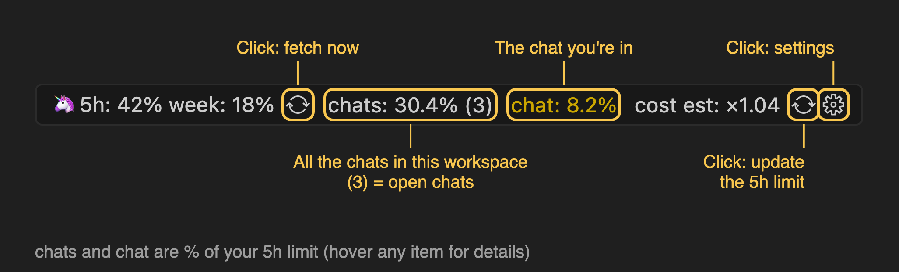
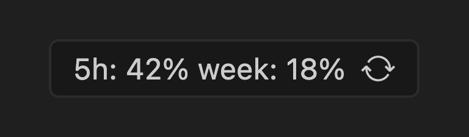
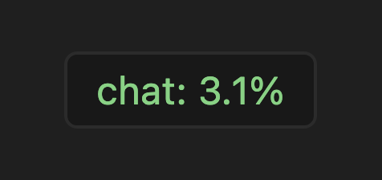

# Claude usage by chat

Your Claude Code usage in the VS Code status bar: the 5-hour and weekly limits, and how much of the 5h limit each chat uses. Unofficial, not made by Anthropic.



**`chats` and `chat` are % of your 5h limit.** Hover any item for details.

- **Setup:** install it, that's all. It starts from your plan's 5h limit. When `cost est` turns yellow, click its ⟳ → **Update** to fit the limit to your real usage ([more](#cost-estimate)).
- **Only this computer counts in `chats` and `chat`.** Claude used elsewhere (claude.ai, your phone, another computer) shows in `5h` and `week` only. If you did, click `cost est` → **Hide until the 5h reset**.
- **Subagents count.** A chat's usage includes the subagents it starts. Each model has its own multiplier, its API price: a token on Opus counts more than on Sonnet, and Sonnet more than Haiku.
- **macOS only for now.** It doesn't work on Windows yet (planned). Linux isn't tested.
- **All local.** Everything is calculated on your computer from Claude Code's own logs. The only network call is to Anthropic's usage API, with the login Claude Code already saved. Nothing is sent to anyone else.

## What each section shows

Turn each one on or off in the settings (click ⚙ at the end of the bar, then **Show …**).

| Section | What it shows | Click |
|---|---|---|
|  | Your real 5h and weekly usage, from Anthropic's server. Hover for when each one resets. | ⟳ fetches it now. |
|  | All the chats in this workspace: their usage in the current 5h window, as % of the 5h limit. `(3)` is how many chats are open. | |
| <br> | The chat you're in now, in the current 5h window. Green when small, then yellow (above 5%), orange (above 10%) and red (above 20%). Hover for the whole chat. | |
|  | CPU and memory of the running chats and of the chat you're in (macOS and Linux). **Off by default:** turn on **Show Cpu Memory**. | |
|  | How far the 5h limit setting is from the real limit (see [Cost estimate](#cost-estimate)). | ⟳ fetches the server and offers to update the limit. |

## Install

In VS Code: Extensions panel → search **Claude usage by chat** → **Install**. Or from the [Marketplace page](https://marketplace.visualstudio.com/items?itemName=uniolik.claude-usage-by-chat). VS Code keeps it up to date.

You need Claude Code installed and signed in. The extension uses the login Claude Code already saved.

## Use it

- Open a Claude Code chat as an editor tab. `chat: N%` follows the tab you're in. The sidebar chat isn't a tab, so the last chat tab seen stays shown.
- A new chat shows up after its first prompt.
- `5h` and `week` come from the server every 5 minutes. Click them to fetch now.

## Cost estimate

The `chats` and `chat` percents are worked out locally against a 5h limit. Anthropic doesn't publish that limit, so the extension starts from your plan (Pro, Max 5x, Max 20x) and then checks itself against the server's 5h percent.

`cost est: ×1.14` means the real limit is smaller than the setting, so your chats really cost 14% more than shown. The colour turns yellow above ×1.05, orange above ×1.20 and red above ×1.30 (time to update). The estimate starts once the 5h usage passes 10%. Before that it shows `?`.

To update the limit, click `cost est` → **Update**. For the most accurate estimate:

1. Stop working in the last 5 minutes before the 5h window resets.
2. After the reset, work in one chat until the 5h usage is above 10%.
3. Click `cost est` → **Update**.

Recalibrate after changing plans. If you used Claude somewhere else in this window (claude.ai, your phone, another computer), choose **Hide until the 5h reset**. That usage isn't in the local logs and makes the estimate wrong.

## Settings

Command Palette → **Claude usage: Settings**, or click `⚙`.

| Setting | Default | What it does |
|---|---|---|
| `claudeUsage.showLimits`, `showChats`, `showChat`, `showCostEstimate` | `true` | Show that section in the status bar. |
| `claudeUsage.showCpuMemory` | `false` | Show CPU and memory of the chats. |
| `claudeUsage.limit5h` | `0` | The 5h limit in weighted tokens. `0` means by your plan (Pro 10,000,000). The extension never changes it on its own: edit it, or click `cost est` → **Update**. |
| `claudeUsage.refreshSeconds` | `60` | How often to recompute 5h, week and chats. |
| `claudeUsage.chatRefreshSeconds` | `5` | How often to recompute the focused chat. |
| `claudeUsage.processStats` | `cpu+memory` | The CPU/memory item: `cpu+memory`, `cpu`, `memory` or `off`. |
| `claudeUsage.processIncludeChildren` | `true` | Count a chat's shell commands and MCP servers in CPU/memory. |
| `claudeUsage.processRefreshSeconds` | `5` | How often to update CPU/memory. |

## How it works and privacy

- It reads Claude Code's own logs in `~/.claude/projects` and `~/.claude/sessions`. Usage is the sum of each message's tokens at that model's API price.
- Every 5 minutes it asks Anthropic's usage API for the real 5h and weekly percent, using the token Claude Code already saved (macOS keychain, or `~/.claude/.credentials.json`). Several VS Code windows share one request.
- That API call goes only to Anthropic. Nothing is sent anywhere else.
- The usage API isn't documented, so it may change or stop working.

## Limitations

- Doesn't work on Windows yet: `chats` and `chat` look for the chat logs in the wrong folder. Linux isn't tested.
- Usage outside this computer (claude.ai, your phone, another computer) counts in `5h` and `week` but not in `chats` or `chat`, and it makes `cost est` wrong for that 5h window.
- Two open chats with the same title: `chat` may show the other one.
- Two VS Code windows on the same folder count each other's chats in `chats`.
- Right after VS Code starts, `chat` can take a few seconds to show correctly.

## Develop

Run it from a clone instead of the Marketplace (uninstall the Marketplace one first):

```sh
git clone https://github.com/Ola1707/claude-usage-by-chat.git ~/Repos/claude-usage-by-chat
ln -s ~/Repos/claude-usage-by-chat ~/.vscode/extensions/local.claude-usage-by-chat-0.0.1
```

Then **Developer: Reload Window**. `npm test` runs the unit tests. [ROADMAP.md](ROADMAP.md) has the plan and the details of how it works.
